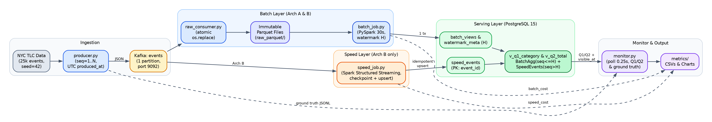
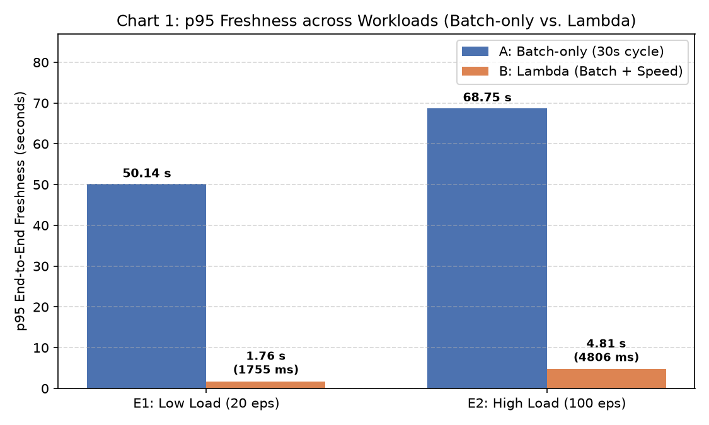
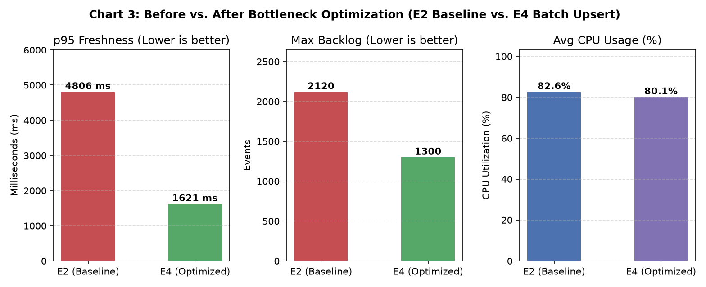
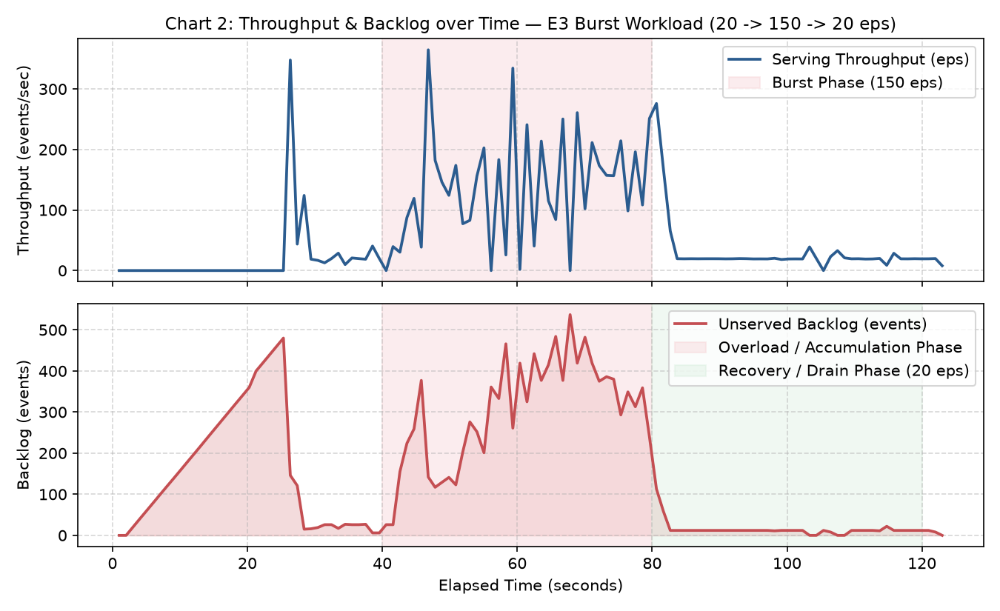
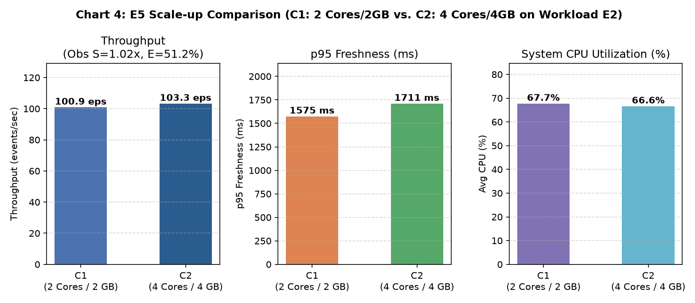
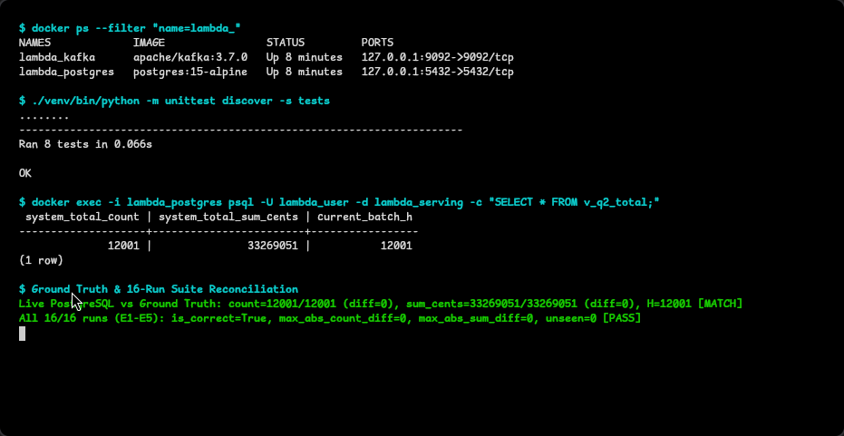

# Lambda Data Pipeline — Real-Time vs. Batch Benchmark

[](requirements.txt)
[](batch_job.py)
[](docker-compose.yml)
[](sql/schema.sql)
[](tests/test_pipeline.py)
[](report/IT4931_Lambda_Pipeline_Report.pdf)

End-to-end **Lambda Data Pipeline** engineered and benchmarked over **2.96M+ NYC TLC Yellow Taxi trip records** (25,000 normalized replay events). The project implements and empirically compares a **Batch-only** pipeline (**Arch A**) against a **Lambda** pipeline (**Arch B**) combining immutable Parquet batch recomputation with idempotent Spark Structured Streaming and an ACID watermark merge in PostgreSQL.

> **Full Technical Report (LaTeX PDF):** [report/IT4931_Lambda_Pipeline_Report.pdf](report/IT4931_Lambda_Pipeline_Report.pdf) ([LaTeX source](report/report.tex))

---

## Key Results at a Glance

All **16 independent benchmark runs** (E1–E5) reconciled with **100% accuracy** against ground truth (`count_diff = 0`, `sum_diff_cents = 0`, `0` unseen samples):

| Experiment | Comparison | Key Result | Resource / Trade-off |
| :--- | :--- | :--- | :--- |
| **E1 (20 eps)** | Batch-only vs. Lambda | p95 freshness **50.14 s → 1.76 s** (**28.6× faster**) | +24.1 pp avg CPU, +684 MB RAM |
| **E2 (100 eps)** | Batch-only vs. Lambda | p95 freshness **68.75 s → 4.81 s** (**14.3× faster**) | +13.3 pp avg CPU, Q1 p95 5.2 → 25.2 ms |
| **E3 (Burst)** | 20 → 150 → 20 eps | Absorbed 7.5× burst (max backlog 537) and drained in **~3–4 s** | 7,596 / 7,596 exact total |
| **E4 (`--opt`)** | E2 Baseline vs. Batch Upsert | p95 freshness **4.81 s → 1.62 s** (**2.97× faster, -66.3%**) | Batch time halved (22.2 s → 10.7 s), lower CPU & RAM |
| **E5 (Scale-up)** | 2c/2g (C1) vs. 4c/4g (C2) | Observed $S = 1.02\times$, $E = 51.2\%$ (input-rate capped at 100 eps) | Batch runtime **-11.3%** (15.45 s → 13.71 s) |

---

## Architecture



### How Exactness Is Guaranteed (`Batch + Speed = Serving`)
1. **Immutable Raw Storage (`raw_consumer.py`):** Consumes Kafka partition `0` with manual offset commits, stages chunks in `raw_tmp/`, and atomically promotes `raw_parquet/part_<min>_<max>_<ts>.parquet` via `os.replace()`.
2. **Contiguous Sequence Watermark $H$ (`batch_job.py`):** Every 30 s, PySpark computes the highest gap-free sequence prefix $H$ starting from `seq = 1`, aggregates `COUNT(*)` and `SUM(amount_cents)` for `seq <= H`, and updates `batch_views`, `watermark_meta.h_seq`, and `batch_seen_events` inside **one ACID transaction**.
3. **Idempotent Speed Layer (`speed_job.py`):** Spark Structured Streaming maintains a checkpoint in `checkpoints/speed/` and inserts events into `speed_events` with `ON CONFLICT (event_id) DO NOTHING`.
4. **Atomic Serving Merge (`sql/schema.sql`):** Views `v_q1_category` and `v_q2_total` union `batch_views` with `speed_events WHERE seq > h_seq`, preventing boundary double-counting or temporary drops when $H$ advances.

---

## Benchmark Charts

| E1/E2 Freshness & E3 Burst Recovery | E4 Optimization & E5 Vertical Scale-Up |
| :---: | :---: |
|  |  |
|  |  |

---

## Environment, Hardware & Versions

* **Host Hardware:** Intel Core i5-10300H (4 cores / 8 threads @ 2.50 GHz), 7.6 GiB RAM (+ 3.8 GiB swap), Arch Linux (kernel `7.2.9-arch1-1`)
* **Runtime & Tools:** Python `3.14.8`, PySpark `4.3.0`, OpenJDK `17.0.21`, Apache Kafka `3.7.0` (`apache/kafka:3.7.0`), PostgreSQL `15-alpine`, Docker `29.9.0`
* **Spark Resource Limits:**
  * Default experiments (E1–E4): `--cores 2 --memory 2g`
  * Vertical scale-up (E5): **C1** (`2 cores / 2g`) vs. **C2** (`4 cores / 4g`), keeping Kafka, PostgreSQL, dataset, and pipeline logic fixed
  * Shuffle partitions: `200` (baseline) vs. `4` (`--opt`)

---

## Quickstart & Reproducibility

### 1. Start Infrastructure & Python Environment
```bash
docker compose up -d
python -m venv venv
source venv/bin/activate
pip install -r requirements.txt
```
*(Wait ~5 seconds for Kafka and PostgreSQL containers to become ready; verify with `docker ps`.)*

### 2. Download & Normalize NYC TLC Dataset
```bash
python prepare_data.py
```
Downloads `yellow_tripdata_2024-01.parquet` (2,964,624 raw rows), applies deterministic cleaning rules (2,861,626 valid rows), samples 25,000 events (`seed=42`), and writes `data/cleaned_events.parquet`, `data/sample_1000_events.csv`, and `data/data_manifest.json`.

### 3. Run a Single Experiment (Arch A or Arch B)
```bash
# Architecture A: Batch-only (20 eps, 120s)
python run_experiment.py --exp-id TEST_A --arch A --rate 20 --duration 120

# Architecture B: Lambda (100 eps, 120s)
python run_experiment.py --exp-id TEST_B --arch B --rate 100 --duration 120

# Architecture B with E4 optimization (batch upsert + tuned partitions/trigger)
python run_experiment.py --exp-id TEST_B_OPT --arch B --rate 100 --duration 120 --opt
```
**State Reset Behavior:** Every invocation of `run_experiment.py` automatically resets `raw_parquet/`, `raw_tmp/`, `checkpoints/`, `logs/`, deletes and recreates the 1-partition `events` Kafka topic, re-applies `sql/schema.sql`, and removes stale `*_batch_cost.csv` / `*_speed_cost.csv` files for that `--exp-id`.

### 4. Run Full E1–E5 Suite, Reproduce E4/E5 & Generate Charts
```bash
# Run all 16 benchmark runs (or resume interrupted runs cleanly)
python run_all_experiments.py --skip-existing

# Reproduce only E4 or E5
python run_all_experiments.py --only E4
python run_all_experiments.py --only E5

# Re-aggregate CSV tables and regenerate all 4 charts
python run_all_experiments.py --aggregate-only
python plot_metrics.py
```

---

## Verification & Automated Tests

Run the unit test suite (watermark prefix logic, partial JSON tailing, active-window freshness sampling, PostgreSQL view deduplication, and error-preserving suite aggregation) and instructor SQL queries:

```bash
python -m unittest discover -s tests -v
docker exec -i lambda_postgres psql -U lambda_user -d lambda_serving < sql/queries.sql
```



*(Full captured command output is saved in [docs/verification_proof.log](docs/verification_proof.log).)*

---

## Repository Structure

```text
.
├── prepare_data.py          # NYC TLC download, cleaning, SHA-256 manifest & 25k sample
├── producer.py              # Rate-controlled Kafka replay & ground-truth JSONL logger
├── raw_consumer.py          # Atomic Parquet archiver (tmp -> os.replace)
├── batch_job.py             # PySpark 30s batch job, contiguous watermark H, ACID commit
├── speed_job.py             # Spark Structured Streaming speed layer & E4 batch upsert
├── monitor.py               # End-to-end freshness poller, Q1/Q2 latency & CPU/RAM tracker
├── run_experiment.py        # Single-run orchestrator with full environment reset
├── run_all_experiments.py   # 16-run E1–E5 suite runner & summary aggregator
├── plot_metrics.py          # Generates 4 benchmark figures in metrics/
├── docker-compose.yml       # Localhost-bound Kafka 3.7 (KRaft) & PostgreSQL 15
├── requirements.txt         # Pinned Python dependencies
├── sql/
│   ├── schema.sql           # Tables, indexes, v_q1_category & v_q2_total views
│   └── queries.sql          # Instructor Q1/Q2 & per-event freshness inspection queries
├── data/
│   ├── data_manifest.json   # Provenance, SHA-256, row counts, seed & cleaning rules
│   └── sample_1000_events.csv
├── metrics/
│   ├── summary_aggregated.csv  # Group-level benchmark table (E1–E5)
│   ├── summary_all_runs.csv    # Per-run results across all 16 runs
│   ├── charts/                 # 4 generated PNG benchmark figures
│   └── runs/                   # Raw per-run timeseries, freshness & cost CSVs/JSONs
├── docs/                       # Architecture diagram & live verification proof log/image
├── report/                     # LaTeX source & compiled IT4931_Lambda_Pipeline_Report.pdf
└── tests/
    └── test_pipeline.py        # Unit & integration tests (8/8 passing)
```
